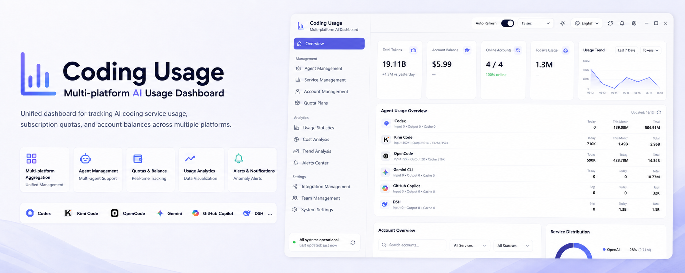

<p align="center">
  
</p>

<h1 align="center">Coding Usage · Multi-Platform AI Usage Dashboard</h1>

<p align="center"><a href="./README.md">中文</a> | English</p>

<p align="center">A Windows desktop app that unifies <strong>real local AI coding-tool usage</strong> with <strong>provider plan quotas, account balances and official subscription limits</strong>.</p>

<p align="center">Fully local · No backend · No tracking · Keys encrypted via the OS keyring, never uploaded</p>

<p align="center">
  
  
  
  
  <a href="./LICENSE"></a>
</p>

---

## What it does

- **Real local agent usage**: [tokscale](https://github.com/junhoyeo/tokscale) scans local session logs, and the main process reads several stores tokscale cannot reach (Cindy's Pi sessions, the CodeBuddy IDE, the Qoder CLI, Trae CN's local database), covering 20-some mainstream tools — Codex, Claude Code, Kimi Code, OpenCode, Gemini CLI, Cursor, GitHub Copilot, Qwen Code, Trae, Cline, Roo Code, Cindy and more. Only tools with data are listed; today / month / all-time columns with an "as of" timestamp. Aggregate numbers only — message content never leaves your machine
- **Provider plans & balances**: multi-account management for 19 providers (table below), each with its own official-endpoint adapter; a provider whose China and international sites are separate accounts gets one entry per site; balances aggregate into the display currency, with a hover breakdown when several pay-as-you-go providers coexist
- **Official subscription quotas**: cards for Codex, Claude Code, Gemini CLI, Grok, Trae CN, Trae (international), Antigravity IDE / App / CLI, Kimi Code, Cursor, GitHub Copilot, Qoder (global), Cline Pass, JetBrains AI, Windsurf, Kiro, Kilo, Factory Droid, Devin, Amp, OpenDesign, Alibaba Cloud Coding Plan, Qwen Cloud and Alibaba Token Plan read the local login or the IDE's own quota file (OpenDesign supports a one-click official device-code sign-in from its card, plus a manual Cookie fallback), showing 5-hour / weekly / per-model windows with reset countdowns — credentials are decrypted only inside the main process, anything written to disk is encrypted with the OS keystore, and saved credentials are never sent back to the UI. Windsurf reads the IDE's local cache, which updates the next time the app is opened; for Antigravity the IDE reads its own login while the app and the CLI share one, and for one account all three cards show the same allowance
- **Alerts**: window-reset, high-usage and low-balance rules with adjustable thresholds in the alerts center, covering both API-key accounts and the subscription cards; an exhausted window says when it recovers, and a window that had raised high-usage announces its restore; hover the top-bar bell for a preview (opening marks them read), with a full alerts center; pushable to WeCom group robots, WeChat (iLink), Feishu / Lark, DingTalk, Discord, Slack, Bark, ntfy and Telegram
- **Desktop experience**: tray-resident, close dialog (minimize to tray or quit), launch on login, light/dark/system themes, zh-CN/en-US locales, auto-update via GitHub Releases

## Supported Providers

| Provider | Type | Description |
|---|---|---|
| **OpenCode Zen Go** | Plan quota | 5h rolling / weekly / monthly windows |
| **GLM Coding Plan** | Plan quota | Zhipu's China site (bigmodel.cn): 5h / weekly windows + MCP monthly calls |
| **Z.ai Coding Plan** | Plan quota | Zhipu's international site (z.ai): 5h / weekly windows + MCP monthly calls |
| **MiniMax Token Plan** | Plan quota | China site (minimax.cn): 5h / weekly quota + video bonus |
| **MiniMax Token Plan Intl** | Plan quota | International site (minimax.io): 5h / weekly quota + video bonus |
| **Volcengine Ark** | Plan quota | Coding Plan windows; AK/SK request signing |
| **Kimi / Moonshot** | Account balance | China site (moonshot.cn): cash + vouchers, CNY |
| **Kimi / Moonshot Intl** | Account balance | International site (moonshot.ai): cash + vouchers, USD |
| **DeepSeek** | Account balance | Multi-currency (CNY / USD), topped-up + granted |
| **SiliconFlow** | Account balance | China site siliconflow.cn, CNY |
| **SiliconFlow Intl** | Account balance | International site siliconflow.com, USD |
| **OpenRouter** | Account balance | Remaining = total credits − usage (USD) |
| **StepFun** | Account balance | Account balance (CNY) |
| **Novita** | Account balance | Available balance (USD) |
| **Command Code GOAT** | Plan quota | Credits + 5h / weekly windows |
| **Ollama Cloud** | Plan quota | 5h / weekly windows |
| **Cursor** | Plan quota | Total, Auto and API measured separately; local login or pasted token |
| **GitHub Copilot** | Plan quota | Premium request allowance; extension login or pasted token |
| **Warp** | Plan quota | Monthly request allowance + add-on credits; paste a dedicated short-lived API key (the key can start billed runs — never your main key) |

## Privacy & Security Boundaries

- Everything (keys, snapshots, scan results) stays local: localStorage + safeStorage encryption (`enc:v3:`) + a userData file mirror; v1→v2→v3 migration is automatic
- The renderer runs inside the Chromium sandbox with a strict CSP; provider data requests go through the main process `net.fetch` straight to official endpoints — **no third-party proxy involved** (the only two exceptions are GitHub-resource mirrors: the model-pricing catalog and the update feed fall back to gh-proxy.com when GitHub is unreachable; neither carries provider data)
- The local agent scan only produces aggregates (tokens, cost estimates, message counts); raw session content never leaves the machine
- Unsigned builds trigger a Windows SmartScreen warning — the Authenticode hookup is prepared (`electron-builder.yml` and the release workflow); configure `WIN_CSC_LINK` secrets once a certificate is purchased

## Download & Install

Grab a build from [Releases](https://github.com/JochenYang/Coding-Usage/releases):

- **Windows**: NSIS installer or portable build. Unsigned builds trigger SmartScreen — click "More info" → "Run anyway"
- **macOS** (Apple Silicon / Intel): currently unsigned — on first launch **right-click the App → Open**, or run `xattr -cr "/Applications/Coding Usage.app"` to drop the quarantine flag; it opens normally afterwards
- **Linux** (x64): `chmod +x Coding-Usage-*.AppImage` and run — no installation needed

## Quick Start

Node.js 22+ required.

```bash
npm install
npm run dev        # Electron desktop app (electron-vite dev, HMR)
npm run dev:web    # Renderer only (http://localhost:5173, desktop features degrade to empty states)
npm run build      # Full build (dist/ + dist-electron/)
npm run dist:win   # Package Windows installers (NSIS + portable)
```

## Releasing

Push a `v*` tag; the release workflow builds all three platforms and generates bilingual release
notes, which you review and publish as Latest. Version rules, the full sequence and local preview:
[docs/development.md](./docs/development.md#发布). Changes are tracked in [CHANGELOG.md](./CHANGELOG.md).

## Adding a New Provider

Core steps (implement `ProviderDef` → register in `registry.ts` → add i18n keys → icon → end-to-end
verification) are in [docs/development.md](./docs/development.md#新增-provider).

## Documentation

- Agent entry point and hard rules: [AGENTS.md](./AGENTS.md)
- Documentation index: [docs/README.md](./docs/README.md) (architecture, development, UI spec, plans, archive)

## Tech Stack

| Layer | Tech |
|---|---|
| **Framework** | React 19 + Vite 7 |
| **Desktop** | Electron 44 (electron-vite + electron-builder + electron-updater) |
| **Language** | TypeScript 5 strict |
| **Styling** | Tailwind CSS v4 (`@theme` token driven) |
| **Animation** | `motion/react` + beui.dev |
| **Icons** | `lucide-react` + `@lobehub/icons` (bundled offline) |
| **Local scan** | tokscale 4.14 (platform binary as optional dependency) |
| **State** | React hooks + `localStorage` (no state library) |

## License

[MIT](./LICENSE)
